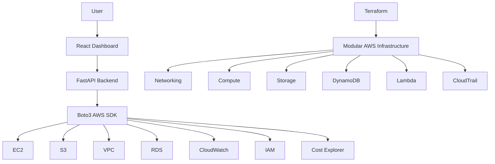

# AWS Enterprise Terraform Platform

A modular AWS infrastructure management platform built using **Terraform, Python FastAPI, Boto3, and React**. It combines Infrastructure as Code, AWS resource visibility, security auditing, monitoring, and cost management through a centralized dashboard.

## Architecture



## Key Features

- Modular Terraform architecture with conditional resource deployment.
- AWS VPC, subnet, routing, and security group provisioning.
- EC2 provisioning with encrypted EBS, IMDSv2, and IAM instance profiles.
- Private S3 storage with versioning, encryption, and lifecycle policies.
- DynamoDB with on-demand billing and optional point-in-time recovery.
- Lambda deployment with IAM execution roles and CloudWatch logging.
- Multi-region CloudTrail auditing and VPC Flow Logs.
- FastAPI REST endpoints for AWS resource information.
- React dashboard with Compute, Storage, Networking, Database, Monitoring, Security, and Cost Optimization sections.
- Checkov security scanning for Terraform configurations.

## Technology Stack

| Category | Technologies |
|---|---|
| Cloud | AWS |
| Infrastructure as Code | Terraform |
| Backend | Python, FastAPI |
| AWS SDK | Boto3 |
| Frontend | React 19, Vite |
| Styling | Tailwind CSS |
| Charts | Recharts |
| API Documentation | Swagger / OpenAPI |
| Security Scanning | Checkov |
| Version Control | Git, GitHub |

## Project Structure

```text
aws-enterprise-terraform-platform/
│
├── .github/
├── backend/
│   ├── main.py
│   ├── aws_client.py
│   └── requirements.txt
│
├── dashboard/
│   └── frontend/
│       └── src/
│           ├── pages/
│           ├── services/
│           ├── App.jsx
│           └── main.jsx
│
├── modules/
│   ├── network/
│   ├── compute/
│   ├── storage/
│   ├── database/
│   ├── serverless/
│   └── audit/
│
├── examples/
├── main.tf
├── variables.tf
├── outputs.tf
├── versions.tf
├── terraform.tfvars.example
├── .terraform.lock.hcl
└── README.md
```

## AWS Infrastructure Modules

| Module | Resources / Capabilities |
|---|---|
| Network | VPC, public subnets, Internet Gateway, route tables, security groups, VPC Flow Logs |
| Compute | EC2, encrypted EBS, IMDSv2, IAM instance profile |
| Storage | S3, versioning, encryption, lifecycle policies |
| Database | DynamoDB, on-demand billing, optional PITR |
| Serverless | Lambda, IAM execution role, CloudWatch logs |
| Audit | Multi-region CloudTrail, S3 audit bucket |

Infrastructure deployment is controlled through Terraform variables. All optional deployment flags are disabled by default to help prevent accidental AWS charges.

## Prerequisites

Install:

- AWS CLI
- Terraform
- Python 3
- Node.js and npm
- Git

Configure AWS credentials:

```powershell
aws configure
aws sts get-caller-identity
```

## Installation and Setup

### 1. Clone the repository

```powershell
git clone https://github.com/718harini/aws-enterprise-terraform-platform.git

cd aws-enterprise-terraform-platform
```

### 2. Configure Terraform

```powershell
Copy-Item terraform.tfvars.example terraform.tfvars

terraform init
terraform fmt -recursive
terraform validate
```

Edit `terraform.tfvars` and enable only the infrastructure modules you want to deploy.

Review and deploy:

```powershell
terraform plan -var-file="terraform.tfvars"

terraform apply -var-file="terraform.tfvars"
```

### 3. Start the FastAPI backend

```powershell
python -m venv backend/venv

.\backend\venv\Scripts\Activate.ps1

pip install -r backend/requirements.txt

python -m uvicorn main:app --app-dir backend --reload
```

Backend:

`http://127.0.0.1:8000`

API documentation:

`http://127.0.0.1:8000/docs`

Health check:

`http://127.0.0.1:8000/health`

### 4. Start the React frontend

Open another terminal:

```powershell
cd dashboard/frontend

npm install

npm run dev
```

Dashboard:

`http://localhost:5173`

The frontend uses `VITE_API_BASE_URL` to configure the backend address. Its default is `http://127.0.0.1:8000`.

Build the frontend:

```powershell
npm run build
```

## Dashboard

The platform provides centralized views for:

- Compute resources
- S3 storage
- Networking
- Database resources
- CloudWatch monitoring
- IAM security audits
- AWS cost information

## Security and Cost Considerations

- S3 public access blocking and server-side encryption.
- Encrypted EC2 EBS volumes.
- IMDSv2 enforcement.
- IAM-based AWS access.
- CloudTrail auditing and VPC Flow Logs.
- Conditional Terraform deployment.
- Cost-conscious resource configurations.
- Checkov security scanning.

**Security note:** Never commit AWS credentials, `.env` files containing secrets, Terraform state files, or sensitive `.tfvars` files.

## Validation

Development validation included:

- Terraform formatting and validation.
- Checkov security scanning.
- FastAPI application import and startup.
- API health endpoint verification.
- Swagger documentation verification.
- React development server and frontend integration.
- Production frontend build.

## Cleanup

Remove Terraform-managed resources when they are no longer required:

```powershell
terraform destroy -var-file="terraform.tfvars"
```

Always review the destruction plan before confirming. Check AWS for any resources created outside Terraform as well.

## Current Integration Note

The Terraform database module provisions DynamoDB, while the current backend database endpoint retrieves RDS instances. DynamoDB dashboard integration is a planned improvement.

## Future Enhancements

- DynamoDB API integration.
- Authentication and role-based access control.
- Automated backend testing.
- CI/CD pipeline enhancements.
- Advanced cost optimization recommendations.
- Expanded monitoring and alerting.

## Author

**Harini**

[GitHub Profile](https://github.com/718harini)

---
**Built to explore practical AWS infrastructure automation, cloud security, and full-stack cloud management.**